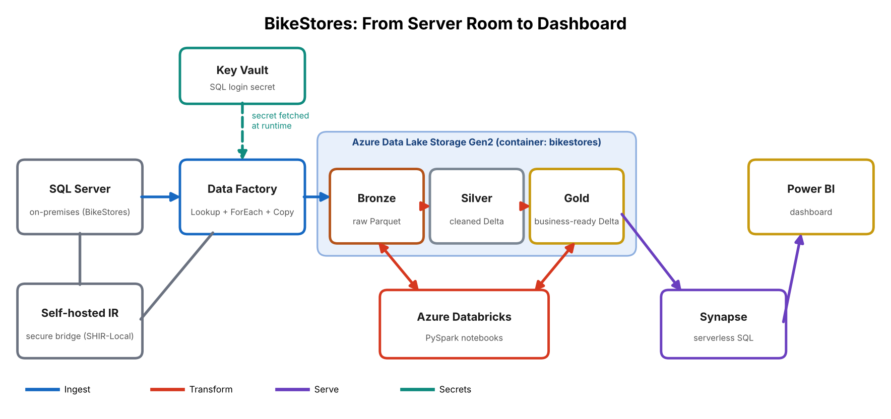
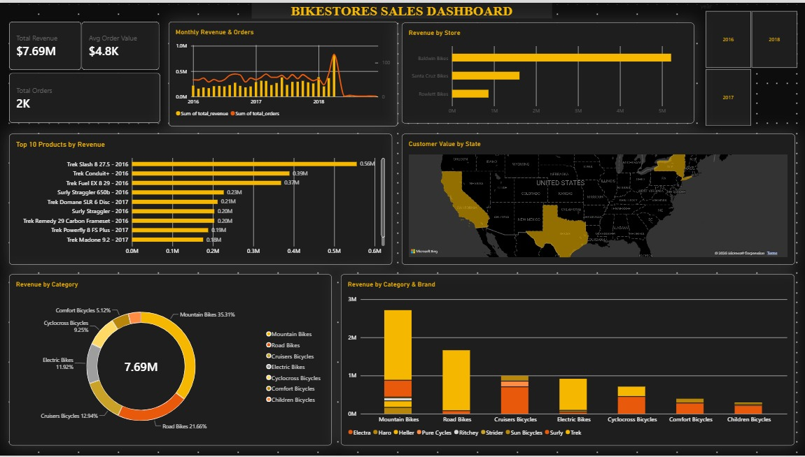

# BikeStores: From Server Room to Dashboard

An end-to-end, secure data pipeline on Azure that moves data from an **on-premises SQL Server** to a **Power BI dashboard** using the **Medallion Architecture** (Bronze, Silver, Gold).

> Course: Cloud Data Engineering | Assignment: *From Server Room to Dashboard* (20% of final grade)



## Table of Contents
1. [Business Problem](#business-problem)
2. [Architecture](#architecture)
3. [Tech Stack](#tech-stack)
4. [Repository Structure](#repository-structure)
5. [Data Model](#data-model)
6. [Pipeline Walkthrough](#pipeline-walkthrough)
7. [Data Quality Checks and Logging](#data-quality-checks-and-logging)
8. [Gold Tables](#gold-tables)
9. [Serving Layer (Synapse)](#serving-layer-synapse)
10. [Dashboard](#dashboard)
11. [Security](#security)
12. [How to Reproduce](#how-to-reproduce)
13. [Results](#results)
14. [Future Improvements](#future-improvements)
15. [Credits](#credits)

## Business Problem
BikeStores keeps sales, customer and inventory data in an on-premises SQL Server. Analysts export spreadsheets by hand, data quality is inconsistent and passwords are shared in scripts. This project builds a secure, automated, cloud-based pipeline that delivers a trustworthy sales dashboard.

## Architecture
```
SQL Server (on-prem) -> Self-hosted IR -> Azure Data Factory -> ADLS Gen2 [Bronze -> Silver -> Gold] -> Synapse Serverless SQL -> Power BI
                                               ^                              ^
                                          Azure Key Vault                Azure Databricks (PySpark)
```

| Stage | Service | Role |
|---|---|---|
| Source | SQL Server (on-prem) | BikeStores operational database |
| Connectivity | Self-hosted Integration Runtime (`SHIR-Local`) | Secure bridge between the on-prem network and Azure, no inbound firewall ports needed |
| Orchestration | Azure Data Factory | Parameterized ingestion pipeline |
| Secrets | Azure Key Vault | Stores the SQL login; ADF reads it at runtime |
| Storage | ADLS Gen2 (`bikestores` container) | Hosts `bronze/`, `silver/`, `gold/` |
| Transformation | Azure Databricks (PySpark) | Bronze -> Silver -> Gold |
| Serving | Azure Synapse serverless SQL | SQL views over Gold Delta tables |
| Reporting | Power BI | Interactive dashboard |

## Tech Stack
Azure Data Factory, Self-hosted IR, Azure Key Vault, ADLS Gen2, Azure Databricks (PySpark, Delta Lake), Azure Synapse Analytics (serverless SQL), Power BI, SQL Server.

## Repository Structure
```
.
├── README.md
├── adf/                      # Exported Data Factory pipeline JSON
├── notebooks/
│   ├── bikestore_bronze.ipynb    # Inspect/verify Bronze folders
│   ├── bronze_to_silver.ipynb    # Cleaning + data quality checks
│   └── silver_to_gold.ipynb      # Business aggregations
├── sql/
│   ├── 01_setup_views.sql        # Synapse views over Gold
│   ├── 02_analytical_queries.sql # Analytical queries
│   └── 03_security_gold_only.sql # Analyst access
├── powerbi/                  # .pbix report
└── docs/
    ├── architecture.png
    ├── Technical_Report.docx / .pdf
    └── screenshots/
```

## Data Model
Source database: **BikeStores** (public sample dataset, no real customer data), two schemas:

- **production**: `brands`, `categories`, `products`, `stocks`
- **sales**: `customers`, `orders`, `order_items`, `staffs`, `stores`

Key tables used for analytics:

| Table | Key columns |
|---|---|
| customers | customer_id, first_name, last_name, phone, email, state |
| orders | order_id, customer_id, store_id, order_date, shipped_date |
| order_items | order_id, item_id, product_id, quantity, list_price, discount |
| products | product_id, product_name, brand_id, category_id, list_price |

## Pipeline Walkthrough

### 1. Ingestion (Data Factory -> Bronze)
Pipeline `copy_all_tables`:
1. **Lookup** activity lists every source table (schema + table name).
2. **ForEach** iterates over the result.
3. **Copy data** activity (one, parameterized) copies each table to `bronze/<schema>/<table>/` in **Parquet**.

Adding a new source table needs **no new activity**; it is picked up by the Lookup automatically. The SQL login is fetched from **Key Vault** at runtime via the linked service.

### 2. Bronze -> Silver (`bronze_to_silver.ipynb`)
- Remove duplicates on business keys
- Standardize data types (int, date, decimal)
- Clean text (trim, proper case, lower-case emails)
- Handle missing values (`phone` -> "Unknown", `discount` -> 0)
- Output as **Delta**

### 3. Silver -> Gold (`silver_to_gold.ipynb`)
Joins order items, orders, products, brands, categories, customers and stores into one sales fact (`revenue = quantity * list_price * (1 - discount)`), then builds the Gold aggregates.

## Data Quality Checks and Logging

| Table | Check | Rule |
|---|---|---|
| customers | Valid email | Matches regex `^[^@\s]+@[^@\s]+\.[^@\s]+$` |
| orders | Valid dates | `order_date` not null, not in the future; `shipped_date >= order_date` |
| order_items | Quantity / price / discount | `quantity > 0`, `list_price > 0`, `0 <= discount <= 1` |
| products | Price | `list_price > 0` |

Every step logs **rows read / rejected / written** and the log is displayed as a table at the end of each notebook.

## Gold Tables

| Table | Rows | Description |
|---|---|---|
| `daily_sales` | 725 | Revenue, orders, units per day |
| `monthly_sales` | 35 | Revenue, orders, units per month |
| `top_products` | 307 | Products ranked by revenue |
| `customer_lifetime_value` | 1,445 | Lifetime value per customer |
| `store_sales` | 3 | Revenue and orders per store |

The sales fact joined **4,722** order-item rows with **0** rows lost.

## Serving Layer (Synapse)
Gold Delta tables are exposed through **serverless SQL views** (`sql/01_setup_views.sql`) using `OPENROWSET(... FORMAT='DELTA')`. Analytical queries are in `sql/02_analytical_queries.sql`.

## Dashboard


- **KPI cards:** Total Revenue ($7.69M), Average Order Value ($4.8K), Total Orders (~2K)
- **Slicer:** Year (2016, 2017, 2018)
- **Visuals:** Monthly revenue & orders, Revenue by store, Top 10 products, Customer value by state (map), Revenue by category (donut), Revenue by category & brand (stacked bar)

## Security
- **No credentials** in code, notebooks, ADF JSON or screenshots; the SQL login lives only in **Azure Key Vault** (`new-key-vault-31-10-26`).
- Data Factory retrieves the secret at runtime, so rotating the secret does not require changing the pipeline.
- Access to the lake is controlled with Azure RBAC / ACLs: analysts get read access to `gold/` only, never `bronze/`.
- The repository contains only synthetic/public sample data.

## How to Reproduce
1. Restore the BikeStores sample database on a local SQL Server / SQL Express.
2. Install and register a **Self-hosted Integration Runtime**.
3. Create an ADLS Gen2 account with a `bikestores` container (`bronze`, `silver`, `gold`).
4. Create a Key Vault and store the SQL password as a secret; give the Data Factory managed identity `Get`/`List` permission on secrets.
5. Create linked services (SQL Server via SHIR with Key Vault secret, ADLS Gen2), then import the pipeline JSON from `adf/` and run it.
6. In Databricks, import the notebooks from `notebooks/` and run `bronze_to_silver`, then `silver_to_gold` (configure access to the storage account through a secret scope or managed identity, never a hard-coded key).
7. In Synapse, run `sql/01_setup_views.sql`, then `sql/02_analytical_queries.sql`.
8. Open the `.pbix` in `powerbi/` and point it at your Synapse serverless endpoint.
9. **Stop/delete** Databricks compute and other resources to avoid charges.

## Results
- Raw data from 9 source tables ingested to Bronze (Parquet)
- Cleaned, validated Silver layer (Delta) with rejection logging
- 5 Gold tables powering a 7.69M revenue dashboard

## Future Improvements
- Incremental loading with a watermark column
- Daily ADF trigger and failure alerts via Azure Monitor
- Delta `MERGE` upserts instead of overwrite
- Unit tests for the transformations

## Credits
Dataset: BikeStores sample database (sqlservertutorial.net). Architecture from the course assignment brief.
